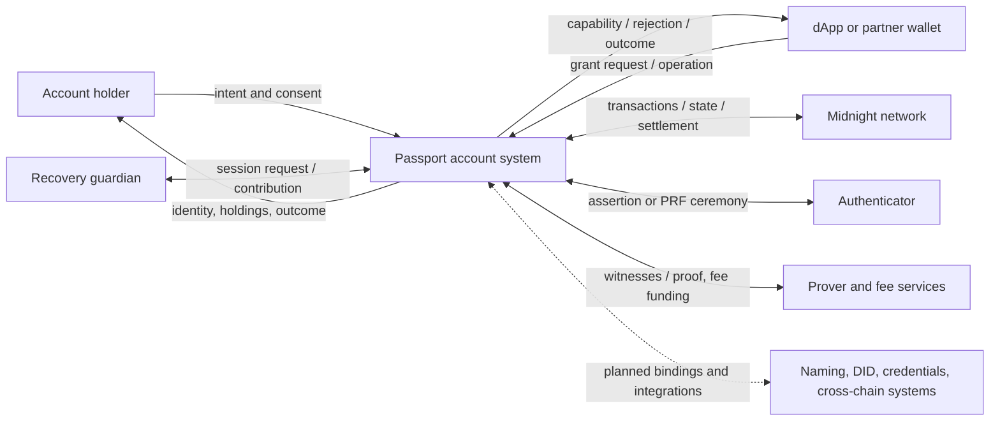
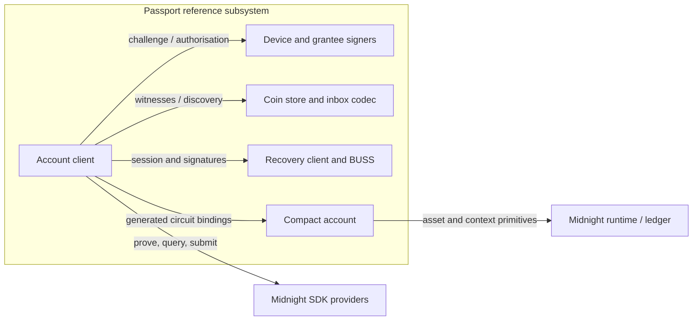
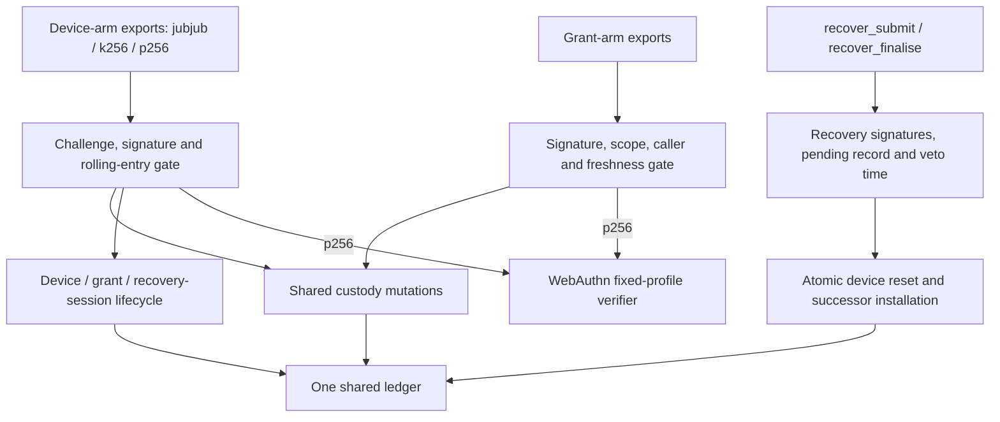
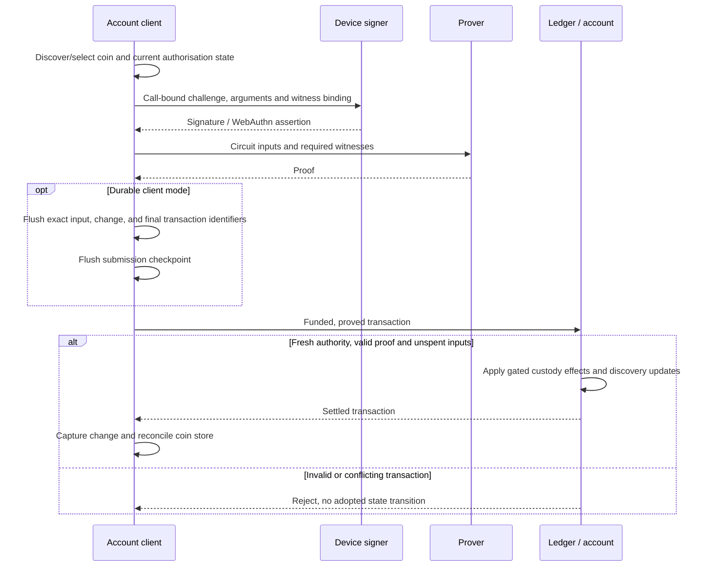
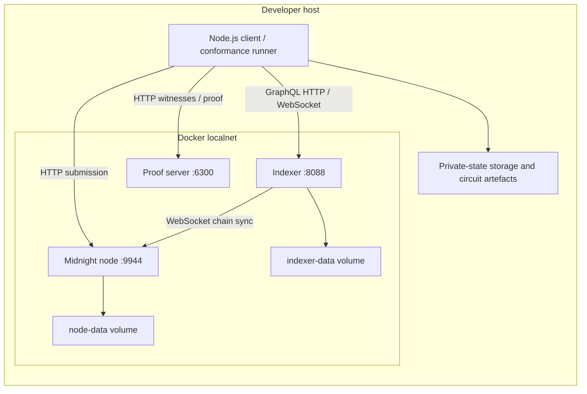

# Midnight Passport — Architecture (arc42)

> **Architectural reference.** This document explains the system, its current
> implementation, and its remaining gaps. The [documentation map](README.md)
> assigns ownership of requirements, standards, decisions, and evidence.

**Review basis — 2026/11/06:** Passport `origin/main` was fetched and resolved to
[`fc19e471536febb2133f20e817847251622dcdf5`](https://github.com/midnightntwrk/passport/tree/fc19e471536febb2133f20e817847251622dcdf5).
The implementation and requirements below were checked against that tree;
this document is a subsequent documentation revision, not content present in
that commit. The canonical standards were separately fetched at
[`02fce36cfa44541305310dc25fd38f399dbe8d92`](https://github.com/midnightntwrk/midnight-improvement-proposals/tree/02fce36cfa44541305310dc25fd38f399dbe8d92).
Evidence retains its own source hashes, toolchain, and run date.
[Quality requirements](#10-quality-requirements) and the
[reference contract guide](../contract/README.md) record verification limits.

The [official arc42 template](https://arc42.org/overview/) supplies the twelve
sections. Linked detail is intentional; source-backed reference views and
future product capabilities are distinguished throughout.

## 1. Introduction and Goals

### 1.1 Requirements Overview

Midnight Passport is the identity and account layer for Midnight: seedless
onboarding, named accounts, independent devices, recoverable custody, scoped
dApp access, and privacy-preserving credentials. The account remains the
control point as devices, services, and integration partners change.

[PROMISES.md](plans/PROMISES.md) owns the requirements and invariant wording.
Feature-complete v1.0 is the destination, not a claim of current completion.

| Requirements | Coverage |
|---|---|
| P1–P5 | Seedless, named, peer-device accounts; lost-device and total-loss continuity. |
| P6–P10 | Key protection, scoped grants, operational autonomy, selective disclosure, chain abstraction. |
| P5′ | Recovery authorisation: configured authority, successor possession, waiting period, and live-device veto. |
| P11–P13 | Transaction safety, value integrity, and funds availability under stated prerequisites. |
| P14–P16 | Private proving, guardian privacy, and upgrade safety. |

The security properties added after the original ten promises matter to the
architecture: recovery availability alone is not authorised recovery; a valid
balance is not proof that funds are spendable; and signature separation alone
is not private proving. Section 10 maps these distinctions to evaluation work.

### 1.2 Quality Goals

This is the architecture's working priority order, not a new stakeholder approval.

| Priority | Goal | Concrete concern / scenarios in section 10 |
|---|---|---|
| 1 | Privacy and integrity | Protect signing keys and custody data; restrict proving/guardian disclosures and prevent unauthorised effects. Q1, Q2, Q7, Q9–Q12. |
| 2 | Operational autonomy | Replace ancillary services without surrendering authority. Q5. |
| 3 | Continuity | Retire compromised authority and recover both control and viewing capability. Q3, Q4. |
| 4 | Interoperability and modifiability | Reproduce signing recipes and preserve custody semantics across arms and authorised changes. Q6, Q8, Q12. |

### 1.3 Stakeholders

| Role | Expectations of the architecture |
|---|---|
| Account holder | Seedless operation, intelligible consent, private holdings, and continuity after loss. |
| Wallet/dApp implementer | Exact interfaces and encodings, reproducible examples, migration rules, and known conformance gaps. |
| Foundation / standards editors | Scope, evidence, and lifecycle distinct from implementation progress. |
| Cryptographer / formal-methods reviewer | Trust assumptions, invariants, construction details, and bounded evidence. |
| Maintainer / operator | Software-to-infrastructure mapping, reproducible builds, failure behaviour, and deployment authority. |

Individual contacts and production operational responsibilities are not assigned here.

## 2. Constraints

| Category | Constraint | Consequence |
|---|---|---|
| Technical | Midnight settlement and Compact circuits | Authority must be checked by circuit/ledger rules, not just client consent UI. |
| Technical | Package-specific compiler/runtime/ledger pins | Use the [reference toolchain](../contract/TOOLCHAIN-0.35.md) and lockfile; demo/experiment results are not interchangeable. |
| Technical | Verifier-key installation budget | Reference deployment uses bounded waves, with maintenance authority explicitly retired or retained according to policy. |
| Technical | `wa-json134` is a bounded WebAuthn profile | Other origin lengths/JSON shapes are not accepted by the production account profile merely because a separate experiment explores them. |
| Organisational | Public standards and partner interoperability | Canonical MIPs own normative text; deviations and acceptance gates remain explicit. |
| Convention | Dated evidence, British prose, exact protocol identifiers | Preserve terms such as `color` and exact domain strings; never “correct” cryptographic bytes editorially. |

October 2026 was the recorded demo milestone. It is not a continuing deadline
or proof of delivery. Upstream-owned subtrees and private/untracked work retain
the boundaries described in the [documentation map](README.md).

## 3. Context and Scope

**Boundary:** Passport comprises client-side account logic and the per-account
custody contract, with planned identity/integration surfaces. Authenticators,
Midnight infrastructure, independently operated dApps, and hosted proving/fee
services are external. Local proving is an alternative client deployment.
The implemented reference subsystem is `contract/`; demo and prototype UX are
separate packages, not evidence of an integrated release.

### 3.1 Business Context

Arrows describe exchanges, not ownership or deployment. Guardian and hosted
proving exchanges have privacy/trust requirements beyond chain-state privacy.
The name direction is `alice.passport.night`; the foundations demo's
`<handle>.night` registry is a different implementation.

### 3.2 Technical Context

| Interface / standard | Exchange and boundary |
|---|---|
| Client ↔ authenticator | WebAuthn assertions for the direct P-256 arm; PRF output for the separate client-derived-key path. These are different key-custody models. |
| Client ↔ node/indexer | SDK submission and GraphQL HTTP/WebSocket state access. Indexer data does not authorise spends. |
| Client ↔ prover | Witness-bearing proof request and resulting proof; remote proving remains a disclosure boundary even without the signing key. |
| Client ↔ account | Generated Compact bindings plus ledger submission; arm-specific circuit ABI, not a direct socket to the deployed contract. |
| dApp ↔ authoriser | [Grant draft](mps-mip/mips/mip-xxxx-scoped-grants.md) §§9–11 defines redirect consent, possession proof, sign-in, CAIP-25 `scopedProperties`, and Open Wallet Standard policy mapping. Carriage is specified; interoperability/ceremony validation remains work. |
| Network identity | MIP-0008 (Draft) supplies CAIP-2 framing. Illustrative network references are not a ratified registry; the grant draft distinguishes feature properties from invokable methods. |
| Ledger signing | MIP-0003 (Accepted) governs secp256k1 ECDSA at the ledger layer; it is distinct from contract authorisation in MIP-0013/MIP-0030. |
| Name service | Passport adopts MIP-0007 (Proposed upstream). Domain acquisition/issuance and deployed registry integration remain dependencies. |
| Cross-contract authority | MPS-0040 frames provenance. Compact 0.35 supplies immediate caller identity, exercised by caller-bound grants; this does not establish calling-circuit identity or complete name-service integration. |

Canonical links and lifecycle observations live in the [standards register](plans/MIPS.md).
MPS-0018 is the custody/account problem statement addressed by MIP-0012,
MIP-0013, and MIP-0022; the grant extension adds bounded authority to that family.

## 4. Solution Strategy

Use per-account contract custody with shared custody logic under distinct
authorisation gates. Unshielded holdings have an explicit balance mirror;
shielded coin descriptions are witness-supplied and discovered through an
encrypted inbox. Devices approve call-bound signatures, separating approval
from proof construction. Grants bound delegated authority independently of
full device membership. Recovery has a signature-based submit/veto/finalise
protocol and must restore the viewing capability as well as control.

| Driver | Approach | Trade-off / boundary |
|---|---|---|
| Privacy/integrity | Signature authorisation and stateless shielded custody | More discovery/private-state management; no blanket proof of all-surface privacy. |
| Continuity | Independent devices and atomic recovery retirement | Individual-device removal still retires only one entry; usable recovery setup is required. |
| Autonomy | Local proving and substitutable infrastructure | Sponsor, browser, guardian transport, and full failover evidence remain separate. |
| Interoperability/change | Dedicated arm exports share custody mutations | More verifier artefacts; precise domain recipes and scheme-specific review. |

The reference now supports `jubjub`, `k256`, and `p256`. The
[former signature-schemes draft](mps-mip/mips/mip-xxxx-signature-schemes.md)
is a pointer to **MIP-0030 (Draft)**, not the earlier unnumbered registry.
Its scheme markers `k1` and `r1` correspond to code suffixes `k256` and `p256`.
Boot/device commitments use `k1:v2` and `r1:v2`; operation challenges retain
`k1:v1` and `r1:v1`. Current upstream recipes agree on that version distinction.

P-256 directly verifies WebAuthn under the [fixed profile](../contract/WEBAUTHN.md):
134-byte client JSON, 21-byte origin, 37-byte authenticator data, and UP+UV.
It is not general WebAuthn support. The PRF → JubJub path instead derives a
signing key in client memory. Separate variable-JSON work is
[experimental](../experiments/webauthn-variable-json/FINDINGS.md); it does not
widen the account profile automatically.

## 5. Building Block View

The [component canvases](plans/components/README.md) map product functions to
promises. The following source decomposition is the implemented reference view.

### 5.1 Level 1 — Reference Subsystem

Arrows are static dependencies. The provider/ledger path realises the logical
client-to-contract interface. This split keeps signer keys and viewing material
under distinct responsibilities while sharing custody semantics across arms.

| Block | Responsibility / interface | Source |
|---|---|---|
| Account client | `CustodyAccount`, call preparation, deployment, capture | [account.ts](../contract/src/wallet/account.ts), [wave-deploy.ts](../contract/src/wallet/wave-deploy.ts) |
| Signers | Context/challenge → authorisation arguments | [signer.ts](../contract/src/wallet/signer.ts), [signer-p256.ts](../contract/src/wallet/signer-p256.ts), [WebAuthn adapter](../contract/src/wallet/webauthn.ts), [Rust signer](../contract/signer-rs/) |
| Private state / inbox | Coin witnesses, sealing/opening, discovery and capture | [witnesses.ts](../contract/src/wallet/witnesses.ts), [inbox.ts](../contract/src/wallet/inbox.ts), [discovery.ts](../contract/src/wallet/discovery.ts), [capture.ts](../contract/src/wallet/capture.ts) |
| Recovery client | BUSS reconstruction, viewing-key wrapping, recovery signatures | [recovery.ts](../contract/src/wallet/recovery.ts), [recovery-gate.ts](../contract/src/wallet/recovery-gate.ts), [buss-rs](../contract/buss-rs/README.md) |
| Account contract | Shared ledger and mutation rules with three arms | [account.compact](../contract/contracts/account.compact), [account-p256.compact](../contract/contracts/account-p256.compact), [webauthn.compact](../contract/contracts/webauthn.compact) |
| Provider adapter | Node/indexer/prover and fee-wallet integration | [node/wallet.ts](../contract/src/node/wallet.ts) |

### 5.2 Level 2 — Account Contract

These blocks share one deployment. JubJub/k256 gates are inline; the P-256 arm
and WebAuthn module are included by the compilation root. Deposits and activation
have their own permissionless checks. `recover_cancel_with_*` is device-gated;
`recover_finalise` is permissionless only for an authorised, uncancelled pending
record after its waiting period. Logical blocks are not separately deployed services.

### 5.3 Product Capabilities and Conformance Boundaries

| Surface | Current source/evidence boundary |
|---|---|
| Custody / authorisation (C1, C4, C5) | Three arms, shared ledger; [reference guide](../contract/README.md) documents deviations and validation layers. |
| Grants (C10–C12, C23) | **`spec_version = 3`** includes caller commitments. Schema-v2 accounts need fresh deployment for v3 scope encoding; an unrelated device-identity remedy has not shipped. |
| Recovery (C13–C15) | MIP-0022; publication, submit, cancel and finalise circuits exist. Finalisation clears all device entries before installing the successor. The old absent-circuit gap against MIP-0013 §8's MUST is no longer present; full conformance is not inferred. |
| Direct passkey authorisation (C5, C9) | `p256` / `wa-json134`; [WEBAUTHN.md](../contract/WEBAUTHN.md) and [measurements](../contract/P256-MEASUREMENTS.md) delimit browser and proof evidence. |
| Proving / viewing state (C6, C16, C17) | Reference client plus bounded [browser-proving](../experiments/account-custody-prototype/BROWSER-PROVING-SCOPE.md) and [viewing-key-sharing](plans/viewing-key-sharing.md) work; not a completed production private-state service. |
| Naming, DID, credentials, cross-chain | Component plans and integration dependencies; no complete product claim. |
| Foundations demo | [Separate package](../demo/mn-passport-foundations/README.md), contracts and recovery placeholders; not reference conformance. |

## 6. Runtime View

### 6.1 Account Creation

The constructor takes `(initial_device_boot, encryption_key,
initial_recovery_pk, initial_recovery_wrap, veto_window_seconds)`.
Deployment cannot form a device entry against the eventual account address.
It stores a salted boot commitment, and the matching arm's activation opens it,
installs the epoch-zero entry, and burns the commitment.

This was **erratum 2 / upstream PR #250**, a correction to the original
MIP-0013 §3 design. The canonical §3 at the pinned standards revision now
specifies dormant deployment followed by activation; it is no longer an
outstanding bootstrap deviation. Arm envelopes/policy extend the recipe.
The [creation flow](protocol-flows/01-first-account-creation.md) gives the sequence.

The client default without `opts.recovery` discards its generated birth secret.
Therefore installed recovery circuits and a stored recovery public key do not
establish usable recovery. Supply a retained recovery configuration or publish
a guardian session while an active device remains.

### 6.2 Device-Authorised Spend

Local execution can also reject before proving/submission. Shielded signatures
bind the qualified coin, including `mt_index`; changing a candidate requires
new approval. A valid proof alone does not guarantee admission or settlement.

The optional [durable change client](../contract/DURABLE-CHANGE.md) records the
submission boundary and reconciles complete, partial, rejected, and unknown
outcomes. Only complete execution permits change qualification and adoption.
Owner recovery backfill is a separately journalled, authorised transaction;
grant change entries are already appended by the circuit and are adopted
without another append. Lost acknowledgements do not authorise resubmission.
The journal supports one writer process and does not establish chain-wide
live/spent discovery or atomic recovery across external viewing-key rotation.

### 6.3 Device Addition and Removal

A live device enrols a derived entry, including across arms. Removal cannot target the
authorising device’s post-roll entry, so that device remains usable. It does not guarantee
that the removed key has no other entry: **erratum 8 remains open**.

Removal also does **not** revoke grants issued by that device. The grant draft
§7.3 requires the owner's client to call `revoke_all_grants` in the same
transaction or immediately after removal for suspected compromise. This is a
client obligation, not a contract cascade or proof that entry retirement is complete.

### 6.4 Scoped Grant

An owner issues a bounded grant; a grantee signs an allowed operation. The
account checks scope openings, nonce, expiry, signature, and an optional
immediate-caller pin before custody mutations. It updates grant-local state
without rolling device entries or advancing `auth_nonce`. Revocation can target
one grant or clear the register and advance `grant_generation`.

`kernel.caller()` identifies the immediate claiming contract, not its circuit,
the root caller, browser origin, or fee payer. The caller's own claim policy
matters. See [caller-bound evidence](../contract/GRANTS-CALLER.md). Ledger spend
enforcement does not enforce off-chain read-capability revocation.

### 6.5 Recovery and Selective Disclosure

1. A device publishes a recovery session with `publish_recovery_session_with_*`.
   The client constructs the BUSS material and viewing-key wrap.
2. Recovery reconstructs client-side authority; `recover_submit` verifies recovery
   and successor signatures bound to account/state and records a pending successor.
3. A live device can veto with `recover_cancel_with_*` during the configured process.
4. After the uncancelled waiting period, `recover_finalise` advances the epoch,
   **resets the complete device set**, and installs only the authorised successor.
   Grants from the prior epoch become inert; finalisation does not need fresh signatures.

The reset addresses **erratum 7**: unchecked opaque entries can embed future epochs,
so an epoch bump alone allows pre-planted authority to survive. Pending-phase
entries must also be retired. This implements the retirement obligation in
MIP-0013 §8/AUTH-6, MIP-0022 REC-8, and P5/I-5.4's continuity intent. The
[23 October run](../contract/GRANTS-COMPLETION.md) proved two corrected recoveries;
its explicit adversarial retirement matrix remains incomplete. Existing deployments
need the corrected verifier or migration; a source merge changes no deployed state.

Selective-disclosure scenarios remain target work in C18–C21, separately from
recovery and grant proofs.

### 6.6 Startup and Failure Scenarios

The operator starts the pinned node/indexer/prover services. The client installs
verifier keys in bounded waves and activates the committed device; an incomplete
roster is not a ready account. Maintenance authority is a security boundary,
not merely deployment bookkeeping.

Out-of-scope grant calls can abort during building, before any proof exists.
Concurrent owner/grantee spends can both prove but only one spend of the same
coin settles. On failure the client must reconcile indexed state before another
attempt; no automatic retry policy is promised. Historical E2 and later grant
records distinguish build-time refusal, proof failure, and node rejection.

## 7. Deployment View

### 7.1 Infrastructure and Software Mapping

| Execution location | Software / artefacts |
|---|---|
| Client host/browser | Account/signing/recovery code, viewing capability, coin store, optional browser prover. |
| Midnight network | Account ledger and installed verifier keys; the account is not a separate network server. |
| Node/indexer | Admission, settlement, state/discovery access. |
| Prover service | Circuit proving with witness access; separate from the signer. |
| Fee wallet/sponsor | External Dust funding path; C24 owns policy/substitutability. |

The current roster is **52 non-pure circuits**: four shared plus sixteen per
arm, with a **15,000-verifier-byte** planning budget and ten waves in the
recorded combined build. See [wave-deploy.ts](../contract/src/wallet/wave-deploy.ts)
and [current validation](../contract/GRANTS-COMPLETION.md). Thirty-circuit v2 and
36-circuit pre-P-256 reports are historical, not current inventory.

### 7.2 Reference Localnet Topology

[Provider configuration](../contract/src/node/wallet.ts) uses node
`http://localhost:9944`, indexer `http://localhost:8088/api/v4/graphql` and
`ws://localhost:8088/api/v4/graphql/ws`, and prover `http://127.0.0.1:6300`.
[Base Compose](../contract/infra/docker-compose.yml) uses host networking;
the [macOS override](../contract/infra/docker-compose.macos.yml) uses a bridge
and published ports. These development channels are not a production security design.

### 7.3 Other Environments and Open Deployment Decisions

The demo and browser-proving experiments have their own execution scope.
Production sizing, availability objectives, backup/restore operations, operator
responsibilities, and maintenance policy require explicit decisions. A recorded
24-GiB Docker allocation for P-256 is not a measured minimum or a general SLO.

## 8. Crosscutting Concepts

### 8.1 Signature versus Secret Witness

Device and recovery approval supply signatures; reconstructed recovery secrets
stay client-side. The old hash-preimage prototype has a different prover trust
boundary. P14 additionally requires a per-profile disclosure inventory across
all off-device services, not just absence of signing keys from a proof request.

### 8.2 Viewing Capability and Control

Viewing-key loss can orphan shielded discovery even when control returns.
The contract does not validate ciphertext contents or viewing-wrap freshness.
Recovery setup, encryption-key rotation, reader exclusion and wrap updates must
be reviewed together; see [viewing-key sharing](plans/viewing-key-sharing.md).
Uncommitted device-secret probes are not acceptance evidence for this baseline.

### 8.3 Hash Domains and Encodings

[MPS-0027](mps-mip/mps/mps-domain-separation.md) frames the problem;
**MIP-0021 is Proposed**, verified at the pinned upstream revision. It rejects
a central registry and differs from existing Passport padding/tag syntax.
[ADR-0001](adrs/0001-domain-separation-registry.md) records the earlier local
registry choice and reconciliation need; [C8](plans/components/C8-domain-separation-registry.md)
tracks compatibility. Do not silently alter deployed bytes. `persistentHash`
(SHA-256) and `transientHash` (Poseidon-family) are not interchangeable.
MIP-0030 preserves the `k1:v2`/`r1:v2` boot/device versus `v1` challenge distinction.

### 8.4 Freshness and Retirement

Device counters, `auth_nonce`, epochs, grant nonces and generations have different
scopes. Recovery must both advance epoch and retire opaque entries; individual
removal and compromise-driven grant revocation remain separate operations.

### 8.5 Substitutable Services

P8/P13 require usable alternative paths, under their stated prerequisites.
Local proving, indexer self-hosting, fee funding and guardian transport need
separate evidence. One component's localnet success does not establish all
service-failure scenarios or a complete product release.

### 8.6 Artefact Distribution

MPS-0039 motivates lightweight interaction; MIP-0020 specifies on-demand prover
keys from bundled ZKIR and chain verifier keys. [Native regeneration evidence](../experiments/proving-key-regeneration/README.md)
is now tracked. Supported SDK/WASM integration and compatibility profiles remain
follow-ups. The broader [circuit-artefact MPS draft (PR #172)](https://github.com/midnightntwrk/passport/pull/172)
is reviewed separately and is not included in this documentation change.
Not all its provenance questions are resolved by MIP-0020.

## 9. Architecture Decisions

Decisions remain in their owning records; this index adds no retrospective approvals.

| Decision area | Rationale, alternatives and current status |
|---|---|
| Domain separation | [ADR-0001](adrs/0001-domain-separation-registry.md); earlier accepted registry choice needs reconciliation with MIP-0021. |
| Naming | [C2](plans/components/C2-name-service.md): adopt upstream naming and resolve integration/policy. |
| Custody | [C4](plans/components/C4-asset-custody-model.md): stateless contract custody and alternative models. |
| Signing | [C5](plans/components/C5-signing-primitive.md): signature/prover separation and scheme costs. |
| Proving | [C6](plans/components/C6-proof-generation.md): local proving and hosted fallback. |
| Device authentication | [C9](plans/components/C9-device-bound-authentication.md): PRF-derived keys versus direct passkey verification and profile limits. |
| Lost-device response | [C13](plans/components/C13-lost-device-flow.md): removal, compromise response, and revocation gaps. |
| Total-loss recovery | [C14](plans/components/C14-total-loss-recovery-flow.md): BUSS selection and MIP-0022 integration. |
| dApp connection | [C23](plans/components/C23-dapp-connection-protocol.md): consent, capability carriage, and transport choices. |
| Fees | [C24](plans/components/C24-fee-model.md): external Dust funding and sponsor-service alternatives. |

## 10. Quality Requirements

### 10.1 Quality Requirements Overview

[PROMISES.md](plans/PROMISES.md) owns all invariants, including P5′ and P11–P16.
Security and continuity are assurance obligations, not completed merely because
the relevant circuit exists. Evidence must distinguish source inspection,
simulator execution, native preprocessing, proof constraints, and node admission.

Current coverage is summarised in [contract/README.md](../contract/README.md).
The earlier “funded unshielded grants are off-node only” limitation was lifted
for JubJub/k256 by [E4](../contract/GRANTS-E2.md#20260916-the-unshielded-grant-twins-on-node-grants-e4).
The 23 October combined-account run also exercised P-256 unshielded grants.
Successful P-256 shielded/forwarded grant calls and full browser/connection
conformance remain outside that run. Clean regeneration of all proving keys is
not implied by reuse of keys after matching textual ZKIR.

### 10.2 Quality Scenarios

These scenarios refine existing requirements; evidence limits are part of each claim.

| ID / requirement | Context and stimulus | Required response / measure | Evidence or remaining gap |
|---|---|---|---|
| Q1 — P6, P5′ | A device or recovery authority approves a separately proved operation. | Zero signing/recovery-secret values cross into proving; signatures bind the intended operation/state. | Source interfaces and recovery gate; complete API/log disclosure review remains separate. |
| Q2 — custody privacy, P14 | An observer inspects account state during shielded custody. | No plaintext shielded coin nonce, color, or value is stored in public account ledger state. | Design requirement supported by schema inspection, **not certified by the leak audit**. Its aggregate positive-control check does not demonstrate detection for every surface and value encoding. Per-surface controls and the wider P14 disclosure inventory remain required. |
| Q3 — I-4.2, P11 | A surviving device removes a compromised key that enrolled multiple entries. | Zero further operations through any entry of that key; client also revokes potentially issued grants. | Entry-scoped removal still fails complete device retirement (erratum 8). Grant draft §7.3 separately requires `revoke_all_grants`. |
| Q4 — I-5.3/I-5.4, P5′ | Recovery completes after valid submit and an uncancelled veto window. | Preserve account/holdings, recover viewing capability, and retain exactly the authorised successor; no prior or pre-planted entry revives. | Reset fixes erratum 7; two corrected recoveries on-node in the 23 October record. Future-epoch/counter/pending-enrolment/all-scheme combinations remain a wider matrix; usable setup and fresh wrap required. |
| Q5 — I-8.2, P13 | An ancillary provider fails while chain and required user material remain available. | Complete the relevant operation through an independent provider or supported self-hosting. | Package-level evidence only; complete provider/sponsor/guardian failover unverified. |
| Q6 — signer interoperability | Independent Rust/TypeScript implementations process identical call inputs. | Agree on specified challenge/encoding bytes and verify signatures; do not assume randomised signatures must be identical. | [crossimpl-offline.ts](../contract/src/tests/crossimpl-offline.ts) covers JubJub/k256 device/grant cases; [auth-crossimpl.ts](../contract/src/tests/auth-crossimpl.ts) is k256-only on-node. No committed raw receipt for that specific on-node run was found; the suite alone is not a run result. [23 October record](../contract/GRANTS-COMPLETION.md) reports offline validation. |
| Q7 — I-7.7, P11 | A grantee exceeds bounds or uses a disallowed immediate caller. | No invalid transfer is adopted; rejected attempts do not mutate account/grant state. | E2/E4, caller evidence, and P-256 combined-account evidence have distinct source/negative-test scopes; no claim every current circuit was exercised on-node. |
| Q8 — modifiability | A new authorisation arm is introduced. | Preserve custody semantics and existing-arm conformance; validate new recipes and policy. | Shared structure supports this; each future arm requires fresh evidence. |
| Q9 — P9 | A user proves a property to different verifiers. | Only the requested property disclosed; no protocol-introduced cross-verifier identifier. | Credential implementation and unlinkability review remain target work. |
| Q10 — P12/P13 | A client restores holdings and attempts a permitted spend with available prerequisites. | Complete report matches identified ledger state; no lost/duplicated movement; missing prerequisites are identifiable. | Discovery/capture and spend evidence are bounded; full restore/failure/accounting acceptance remains open. |
| Q11 — P14/P15 | Proving and guardian protocols exchange data with external parties. | Each supported profile has an exhaustive disclosure inventory; observed exchanges stay within it. | Signature secrecy alone is insufficient; transport/prover/log and guardian-collusion analysis remain work. |
| Q12 — P16 | Verification logic is updated where maintenance is available. | Update is account-authorised and preserves authority, holdings, identity observations and availability under the defined policy. | Wave installation is not a general proof of upgrade safety; retired maintenance requires migration rather than a silent update. |

Performance, memory, throughput, recovery-time and availability thresholds are
not agreed SLOs here. Owners must choose a device/network profile and acceptance
budgets. I-8.1's literal “chain state alone” also needs reconciliation with
private signing/viewing capability; this document does not silently rewrite it.

## 11. Risks and Technical Debt

Priorities below reflect architectural impact, not an approved schedule or likelihood model.

| Priority / ID | Risk and consequence | Mitigation / next decision |
|---|---|---|
| High R1 | Individual-device removal leaves sibling entries live; compromise may leave issued grants usable. | Resolve erratum 8 in C1/C13; apply grant draft's client revoke-all obligation. Do not attribute the device-identity remedy to schema v3. |
| High R2 | Misconfigured/stale recovery material or old deployed finalisation can defeat continuity or I-5.4. | Require usable setup and wrap lifecycle; deploy corrected atomic retirement for erratum 7; expand adversarial matrix. The source reset and bounded node evidence are present, not a remaining absent-circuit defect. |
| High R3 | Overstated privacy or cryptographic evidence conceals unsupported assurances. | Per-surface leak controls, complete disclosure profiles, independent/cryptographic review, and explicit proof-versus-runtime distinctions. |
| High R4 | Production deployment/quality commitments and I-8.1 interpretation unresolved. | Set operations, authority, and quality criteria before production readiness. |
| Medium R5 | Immediate caller identity mistaken for circuit authority or completed naming integration. | Review caller claim policy and actual registry integration; MPS-0040/C2/C12. |
| Medium R6 | Proof artefact size and build compatibility constrain distribution and reproducibility. | Track MPS-0039/MIP-0020 and the broader [artefact MPS draft (PR #172)](https://github.com/midnightntwrk/passport/pull/172); retain source/key provenance and wave budgets. |
| Medium R7 | Standards, implementation and historical observations drift. | Maintain pinned review bases and [the standards register](plans/MIPS.md); update affected views together. |

## 12. Glossary

| Term | Meaning |
|---|---|
| ACC / account | Account Custody Contract: one account's custody and authorisation state. |
| MIP / MPS | Midnight Improvement Proposal / Midnight Problem Statement. |
| Arm | Scheme-specific circuit family; `k256` = scheme marker `k1`, `p256` = `r1`. |
| Device entry | Rolling opaque commitment, not a unique durable device identity. |
| Grantee | Key bounded by a grant record rather than full device membership. |
| Viewing capability | Secret material required to decrypt discovery data. |
| Witness | Private circuit input; not necessarily a signing key. |
| PRF | Pseudorandom function; WebAuthn output can feed a client derivation profile. |
| BUSS | Bottom-up secret sharing used by the recovery construction. |
| ZKIR | Circuit intermediate representation used in proving/key-generation tooling. |
| Dust | Midnight fee resource supplied outside account asset custody here. |
| ABI | Exported circuit names, parameters, encodings, and verifier artefacts. |
| SLO | Agreed measurable operational objective, not an experiment timing. |
| CAKE | **Chain Abstraction Key Elements**, Frontier Research's framework. Its four layers are Applications, Permission, Solver, and Settlement; see [the primary source](https://frontier.tech/the-cake-framework). |

### Maintenance

Change the owning source first, then update the affected architecture view,
scenario, component and presentation. Record the actual reviewed source revision
and keep evidence dates distinct. Follow the [maintenance rules](README.md#maintaining-the-reference).
A document update or a passing link check does not establish conformance.
