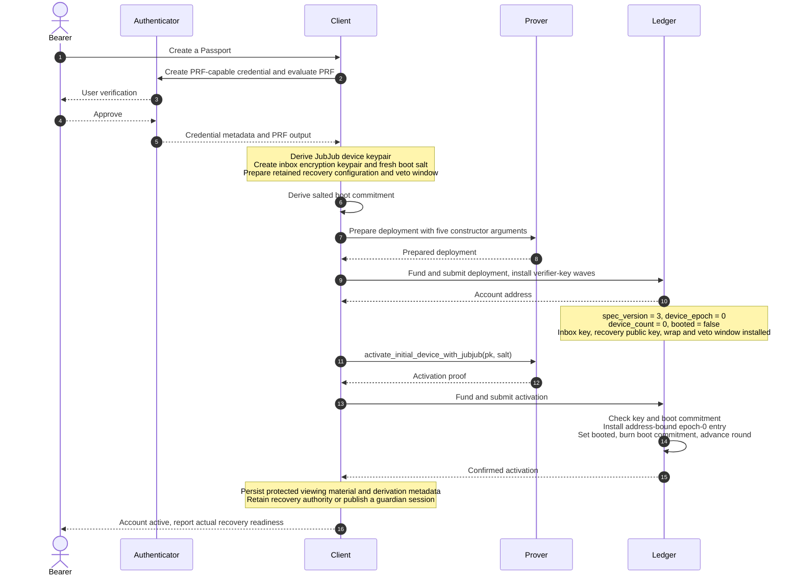

# First-time account creation

This flow describes the **JubJub reference bootstrap** at Passport main
`fc19e47`, reviewed 2026/11/06. A PRF-capable authenticator can supply material
for a client-derived device key; the WebAuthn UI is a client responsibility,
demonstrated separately in the prototype. Direct P-256 WebAuthn is another
arm with different key custody and bounded profile requirements.

**Preconditions.** A PRF-capable authenticator for this client path, a client
able to derive the JubJub key, a proving path, and transaction fee funding or
sponsorship. Usable birth recovery additionally requires a retained recovery
configuration; alternatively, publish a guardian session after activation.

**Postcondition.** The custody account has one active epoch-zero device,
an inbox encryption public key, and recovery state. It can receive assets and
authorise operations. Recovery is usable only if the corresponding recovery
authority and viewing capability can actually be reconstructed.

## Participants

- **Bearer** — the person creating the account.
- **Authenticator** — protects the credential and gates PRF evaluation.
- **Client** — derives the device key, holds viewing material and builds calls.
- **Prover** — proves prepared operations locally or remotely.
- **Ledger** — checks deployment/activation and applies accepted state changes.

## Diagram

## Narrative and security boundary

The [constructor](../../contract/contracts/account.compact) takes
`(initial_device_boot, encryption_key, initial_recovery_pk,
initial_recovery_wrap, veto_window_seconds)`. It cannot bind an initial entry
to its own eventual address, so it stores a salted boot commitment.
Permissionless activation checks the committed key and salt, rejects
small-order keys, installs the address-bound entry, and burns the commitment.
Repeated activation is rejected. This two-stage design was authorisation
erratum 2; upstream PR #250 incorporated it into MIP-0013 §3. It is no longer
an outstanding deviation at the [reviewed standards revision](../plans/MIPS.md).

The k256 and p256 arms use their own boot derivations and envelopes/policy.
The direct P-256 arm verifies authenticator assertions under
[`wa-json134`](../../contract/WEBAUTHN.md). In this PRF/JubJub path, by contrast,
the derived signing key exists in client memory. Later authorisation passes
signatures to the prover, not that private key.

Viewing material is distinct from device authority. Losing it can prevent
shielded inbox discovery even if account control survives; an account address
and credential id are not a sufficient backup. The contract stores the recovery
wrap but cannot verify its plaintext or freshness.

**Client default caveat:** [CustodyAccount](../../contract/src/wallet/account.ts)
without `opts.recovery` generates and discards a birth secret. This establishes
valid recovery state, not usable recovery. Supply the retained configuration
or publish a guardian session while an active device remains. The interface
must not describe an account as recoverable merely because its circuits exist.

Bootstrap does not create a human-readable name or complete guardian transport.
Sponsorship removes the need for bearer pre-funding only when an actual funding
path is available. An incomplete verifier roster is not a ready account.

## Implementation and evidence

- [Reference guide](../../contract/README.md),
  [authorisation suite](../../contract/src/tests/auth-conformance.ts), and
  [23 October combined-account record](../../contract/GRANTS-COMPLETION.md):
  current source and dated deployment/recovery evidence. A test source is not
  itself a fresh execution result; the recorded run used matching cached keys.
- [Account-custody prototype](../../experiments/account-custody-prototype/README.md):
  separate passkey/recovery UX evidence with earlier contract semantics.
- [Foundations demo](../../demo/mn-passport-foundations/README.md): separate
  contracts and recovery placeholders, not this reference account.
- [Standards register](../plans/MIPS.md) and [arc42](../arc42.md): canonical
  MIP-0012/0013/0022 links, implementation boundaries and remaining review gates.

Uncommitted deployment/device-secret probes from the old documentation branch
are not evidence for this sequence and are not dependencies of this document.
